---

<p align="center">
  <a href="docs/安装.md#requirements"></a>
  <a href="docs/API/设备与执行.md#default-device"></a>
  <a href="docs/安装.md#installation-variants"></a>
</p>

FugaTensor 是基于 [ASK](../ask/README.md) 的张量计算框架。张量运算先记录为 Fuga IR；读取结果、判断标量条件或调用 `ft.evaluate` 时，再编译并交给 CPU 或 CUDA 执行。

```python
import fugatensor as ft

def arithmetic(x, y):
    return (x + y) * 2

x = ft.tensor([[1, 2], [3, 4]])
y = ft.tensor([[10, 20], [30, 40]])
print(arithmetic(x, y).tolist())
# [[22.0, 44.0], [66.0, 88.0]]
```

默认使用 CPU 和 `ft.fp32`。其他精度通过 `dtype=ft.fp16` 等类型对象指定，设备使用 `ft.device("cuda", 0)` 或 `"cuda:0"`。`ft.set_default_device(...)` 设置后续张量的默认设备。

按尺寸创建张量和改变形状可以直接写：

```python
x = ft.ones(2, 2)
y = ft.tensor([1, 2, 3, 4]).reshape(2, 2)
print((x + y).reshape(-1).tolist())  # [2.0, 3.0, 4.0, 5.0]
```

`tensor` 从嵌套数据推断形状，`zeros`、`ones`、`empty` 接受尺寸参数，`full(size, value)` 指定填充值。`reshape` 保留元素次序和梯度连接，支持用一个 `-1` 推断尺寸。详见[张量创建与形状](docs/API/张量与数据交换.md#size-factories)。

接口用法见 [API](docs/API/README.md)。设计细节见 [文档目录](docs/README.md)、[架构总览](docs/architecture/README.md) 与 [Fuga IR 总览](docs/ir/README.md)。

<a id="setup"></a>

## 独立构建与安装

先安装 ASK C++ SDK，再通过 `CMAKE_PREFIX_PATH` 构建 FugaTensor。生成的 wheel 携带 ASK 编译器和运行时共享库。原生扩展通过 [ASK 的具名阶段结果](docs/architecture/ASK桥接与多后端执行.md#compiler-results)接收编译产物与诊断。

```bash
CMAKE_PREFIX_PATH=/absolute/path/to/ask-sdk python3 -m pip wheel --no-deps . --wheel-dir dist
```

`fugatensor[pure]` 使用基础依赖，`fugatensor[all]` 额外安装 Triton。两者共用一个 wheel，直接安装 `fugatensor` 等同 pure。命令和环境要求见[安装选项](docs/安装.md#installation-variants)。

CPU JIT 使用 `cc` 和 libm，fp32 矩阵乘法链接 ASK SDK 提供的 OpenBLAS。自有 CUDA 计算使用 `llc` / `ptxas`；指数与对数另链接 CUDA libdevice，矩阵乘法使用 cuBLASLt，fp32 允许 TF32 乘法。构建依赖、工具配置和开发引导见[安装文档](docs/安装.md)。

## 基本用法

### 1. 函数式自动微分与自定义 VJP

```python
def loss(x):
    return ft.square(x) + 3 * x

x = ft.tensor(2.0)
y = loss(x)
first = ft.grad(y, x)
print(first.tolist())           # 7.0
print(ft.grad(first, x).tolist()) # 2.0
```

`ft.grad` 返回待计算的导数 Tensor；读取后仍可继续求导。非标量输出须通过 `seed=` 传入同形状、同类型的余切种子。`ft.stop_gradient(x)` 或 `x.detach()` 显式断开求导路径，也可用于 `ft.fun` 的前向与 VJP。

自定义函数继承 `ft.fun`，普通前向自动求导，也可提供纯 VJP 规则：

```python
class CustomSquare(ft.fun):
    def forward(self, x):
        return ft.square(x)

    def vjp(self, primals, outputs, cotangents):
        (x,) = primals
        (dy,) = cotangents
        return (2 * x * dy,)
```

三个 VJP 参数均为 tuple，返回浮点 Tensor 输入的梯度 tuple。梯度图可组合为更高阶导数，活跃路径须有对应规则。详见[自动微分 API](docs/API/自动微分与自定义函数.md)与[IR 变换](docs/architecture/自动微分与自定义算子.md)。

### 2. 接入用户 Triton 算子

`ft.triton.from_source(source, ...)` 注册源码字符串，`ft.triton.kernel(path, ...)` 读取 kernel 文件，`ft.triton.from_jit(fn, ...)` 注册已有 JIT 对象。返回的算子可与普通张量运算组合。

注册时保存源码快照，worker 将其编译为 cubin，ASK 按图依赖调度。标量、多输出和编译配置见[Triton 接入](docs/API/Triton算子接入.md#example)，环境准备见 [Triton 配置](docs/安装.md#configure-triton)。

内置 attention 使用 `ft.nn.functional.scaled_dot_product_attention(q, k, v, is_causal=True)`，支持 CUDA fp16/bf16 前向和一阶反向。形状要求见[attention API](docs/API/attention.md)。

### 3. 查看 IR、溯源产物与缓存统计

```python
x = ft.tensor([1, 2, 3])
y = (x + 1) * 2
ft.evaluate(y)                   # 显式执行；多个输出可一起传入
engine = x.engine                # 需要诊断时查看框架管理的引擎
print(engine.cache_info())       # 图缓存条目、编译次数与内存命中统计
print(engine.last_fuga_ir)        # 最近执行的 Fuga IR
print(engine.last_ask_ir)         # 提交给 ASK 的 MLIR 文本
print(engine.last_report)        # 编译诊断与缓存统计
print(engine.last_execution_plan) # CUDA 分区计划；此 CPU 示例为 None
print(engine.last_artifact_dir)  # fuga.ir、frontend.mlir 与 fuga-to-ask.json
```

`ft.evaluate(a, b)` 合并并求值两个输出的依赖图，返回原 Tensor。`shape`、`dtype`、`device` 和 `repr` 读取元信息。Python 的 `if`/`while` 在读取 0-D Tensor 真值时执行条件计算，再沿实际路径继续组图；`ft.fun` 内的数据依赖控制流会报错。

引擎按图模板和连接关系查询缓存，命中后复用组合与编译结果，Python 函数照常执行。连续数据可通过 `ft.from_buffer(...)` 导入、`tensor.to_buffer()` 导出，详见 [buffer 接口与寿命规则](docs/architecture/张量模型与追踪机制.md#buffer-io)。

## 当前支持范围

| 项目 | 当前行为 |
| --- | --- |
| **数据类型** | 默认 `ft.fp32`；支持 `ft.bool`、`ft.int32`、`ft.int64`、`ft.fp32`、`ft.fp16`、`ft.bf16`，用 `.astype(...)` 显式转换；bf16 Tensor 使用 CUDA |
| **张量创建与基础运算** | `tensor`、`zeros`、`ones`、`empty`、`full`；加减乘除、指数/对数/平方根、比较选择、显式广播与转置、归约、矩阵乘法（静态形状，含 0-D 与空张量） |
| **控制流** | Fuga IR 静态 `if` 选择与有界 `for` 展开；普通 Python 支持 0-D Tensor 的 `if`/`while`，条件读取触发按需执行 |
| **自动微分** | `ft.grad(outputs, inputs, seed=...)` 延迟求导、`detach()` / `stop_gradient()`、`ft.fun` 纯 VJP、导数图组合与高阶求导 |
| **注意力** | `nn.functional.scaled_dot_product_attention`，CUDA fp16/bf16、可选因果掩码、FlashAttention 前向及一阶反向 |
| **权重导出** | 版本化 PyTree 权重目录，支持嵌套 dict/list/tuple、六种基础 dtype、内容寻址去重、原子导出与完整性校验 |
| **执行后端** | CPU（`.o` → `.so` → `ctypes`）、自有 CUDA、Triton cubin 与多 kernel 调度，支持多端口和按值标量 |

外部 kernel 的微分通过纯 VJP 规则提供；高阶微分沿导数图的活跃路径组合对应规则。内置 FlashAttention 提供一阶导数。

## 测试

数值测试按算子、精度与关键边界生成代表组合，状态和生命周期保留独立契约测试。`--exhaustive` 扩展同一生成器的组合。运行和扩展方式见[测试矩阵](docs/测试.md)。

```bash
# CPU 编译、C++ 原生图分析、Fuga IR / JVP / VJP 与降级测试
.venv/bin/python -m pytest -q

# 启用物理 GPU 自有 CUDA 测试
.venv/bin/python -m pytest -q --cuda

# 同时启用自有 CUDA 与用户 Triton GPU 调度及反向测试
.venv/bin/python -m pytest -q --cuda --triton
```

## 文档

- [安装与独立构建](docs/安装.md)
- [文档目录](docs/README.md)
- [API](docs/API/README.md)：张量与数据交换、基础运算、设备与执行、自动微分与自定义函数、Triton 接入、权重读写、IR 与降级、attention。
- **系统架构（`docs/architecture/`）**：[架构总览](docs/architecture/README.md) · [张量模型与追踪机制](docs/architecture/张量模型与追踪机制.md) · [原生图分析与 C++ 边界](docs/architecture/原生图分析与C++边界.md) · [自动微分与自定义算子](docs/architecture/自动微分与自定义算子.md) · [ASK 桥接与多后端执行](docs/architecture/ASK桥接与多后端执行.md) · [权重格式与导出](docs/architecture/权重格式与导出.md)
- **中间表示（`docs/ir/`）**：[Fuga IR 总览](docs/ir/README.md) · [对象模型与验证](docs/ir/对象模型与验证.md) · [控制流与可组合变换](docs/ir/控制流与可组合变换.md) · [降级到 ASK](docs/ir/降级到ASK.md)

[多 kernel 计划契约](../ask/docs/图切分与多Kernel执行计划.md) · [attention API](docs/API/attention.md) · [权重格式与导出](docs/architecture/权重格式与导出.md)
