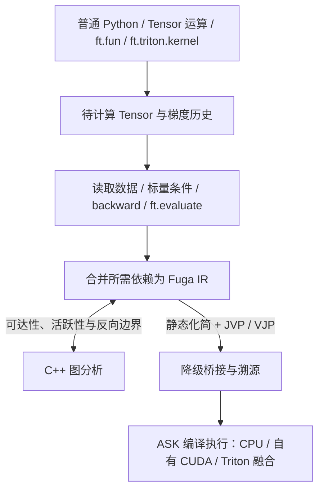

# FugaTensor 架构总览

目录导航：[文档目录](../README.md) · 中间表示：[Fuga IR 总览](../ir/README.md) · 底层引擎：[ASK 核心思想](../../../ask/docs/核心思想.md)

FugaTensor 负责 Python 张量接口、自动组图与按需执行、结构化中间表示（Fuga IR）与自动微分变换；所有张量算术计算均编译为原生 CPU 代码或 CUDA kernel 交由 [ASK](../../../ask/docs/核心思想.md) 执行。

## 1. 两层系统边界

静态编译后端接收的是形状确定、无动态分支的单基本块数据流，而上层框架还需要表达未展开的 `if`/`for`/`while` 区域、`ft.fun` 自定义求导边界（`fuga.call`）以及高阶导数变换。因此系统划分为两层：

- **FugaTensor（框架层）**：管理 `Tensor` 存储与梯度历史、待计算表达式合并、Python 标量条件执行边界及自定义函数隔离追踪、基于独立 Fuga IR 的前向/反向自动微分（JVP/VJP）、C++ 反向路径预检与无用输入端口剪枝。
- **ASK（编译与运行时层）**：校验 `ask` dialect 静态图、执行常量折叠与逐元素融合、将自有算子或 `ASK → Triton → ASK` 跨编译器边界降级为目标机器码，并通过常驻 `ExecutionSession` 与双层磁盘缓存执行。

工程细节：[Fuga IR 总览](../ir/README.md) · [ASK 与 FugaTensor 协同分工](../../../ask/docs/07-FugaTensor协同与演进路线.md#division-of-labor)

## 2. 张量模型、自动组图与执行边界

Tensor 持有 CPU/CUDA 存储，或记录尚未计算的表达式及已知形状、类型和设备。`x + y`、`x.astype("f16")` 等运算自动组图；普通 Python 函数每次正常运行，无需装饰器。跨函数调用仍保留同一数据流与融合机会。

读取数据、0-D 标量条件判断、`.backward()` 或 `ft.evaluate(...)` 触发 JIT。引擎回溯所需输出，把依赖表达式合并为 Fuga IR，再查询图编译缓存并执行。`ft.evaluate(a, b)` 可以一起计算多个输出；已计算 Tensor 的重复读取不再执行。

Python `if` / `while` 通过条件 Tensor 的实际真值选择路径，后续运算继续组图。数据依赖控制流可写在普通 Python 中；`ft.fun` 方法仍在隔离追踪中形成完整子函数，不支持读取张量条件。

工程细节：[01. 张量模型与追踪机制](01-张量模型与追踪机制.md)

## 3. 独立 Fuga IR 与 C++ 原生图分析

组图产出的 `fugatensor.ir.Module` 是设备无关的 SSA 对象图（支持嵌套 `Region` 与结构化验证），同一函数在 CPU 与 CUDA 上生成相同的 Fuga IR。

求导预检、死代码消除（DCE）和输出投影依赖的图拓扑分析在必选 C++ 扩展 `fugatensor._native`（`cpp/graph.cpp`）中完成：

- 单次分析算出前向种子可达集、输出逆向可达集、带副作用保活集、微分子图交集以及逆拓扑待求导算子序列；
- 区分纯数据流与带副作用节点（effectful ops），未流向目标输出的外部算子不会进入反向求导序列；
- C++ 实现不持有全局可变状态并在分析期间释放 GIL，`ir/transforms.py` 在其上封装 `analyze_function`、`prune` 与 `project_outputs` 供求导与执行引擎共用。

工程细节：[02. 原生图分析与 C++ 边界](02-原生图分析与C++边界.md) · [Fuga IR 对象模型与验证](../ir/01-对象模型与验证.md)

## 4. 运行时自动微分、`ft.fun` 与高阶求导

公开求导接口采用 `requires_grad=True`、`y.backward(seed)` 与叶子张量 `.grad`，底层微分基于 Fuga IR 图变换实现：

- **反向调度与预检**：构建表达式时，若输入含需要梯度的张量且未处于 `no_grad`，输出即记录 Fuga IR、正向实参与梯度历史；数值执行时间不改变这条边界。调用 `.backward()` 时先按拓扑逆序扫描历史 DAG 完成预检（Preflight Validation）：若必经路径上存在缺少反向规则的不透明外部算子，在启动反向编译或更新 `.grad` 之前直接报错。
- **`ft.fun` 自定义算子**：继承 `ft.fun` 并定义普通 `forward` 与可选 `backward` 方法；追踪期生成带 `saved` 中间值端口的 `fuga.call`，求导期将其替换为 `backward` 对应的 Fuga IR 子图（支持在 `backward` 中调用手写 Triton kernel）。
- **高阶求导（`create_graph=True`）**：基础算子（`constant`、`splat`、`add`、`mul`、`cast`）的 `jvp` 与 `vjp` 规则生成的仍是这五种基础算子；开启 `create_graph=True` 时，反向计算继续组图、合并并由 ASK 执行，同时记录梯度历史，支持继续调用 `.backward()` 求高阶导数。

工程细节：[03. 自动微分与自定义算子](03-自动微分与自定义算子.md) · [控制流与可组合变换](../ir/02-控制流与可组合变换.md)

## 5. 降级到 ASK、多后端执行与多级缓存

完成控制流化简、微分与无用输入端口裁剪后，`lower_to_ask` 将 Fuga IR 转换为 ASK `Module`，写出 `fuga.ir`、`frontend.mlir` 与逐值映射表 `fuga-to-ask.json`，再由 `Engine` 分派执行：

- **CPU（`HostBackend`）**：核对进程内 SDK 与伴生 `ask-opt` 声明的构建身份匹配后，调用 `ask-opt --optimize --emit-object` 生成目标文件并由 `cc -shared` 链接为动态库，通过 `ctypes` 按报告中的端口 ABI 调用函数指针。
- **自有 CUDA**：从常驻 `ExecutionSession` 查询当前 GPU 的 `sm_xx` 架构，调用 ASK 自有 CUDA 降级生成 `cubin` 并异步 `submit_many`。
- **用户 Triton 算子与多 kernel 调度**：`ft.triton.kernel` 读取并保存 `@triton.jit` 源码文本，在确定目标 GPU 后填入架构号生成 `ask.external`。ASK 保留可证明的 `P → F → Q` 逐元素融合；多输入、复杂算子或融合证明失败时，按[执行计划 v1](../../../ask/docs/08-图切分与多Kernel执行计划.md#plan-v1)切成多个 kernel 并在同一 stream 顺序调度。
- **安装与缓存**：ASK 是必需的运行依赖，两个项目各自构建 wheel 后安装到同一环境；FugaTensor 自身的构建不读取 ASK 源码。CPU 包安装无需配置文件，CUDA 工具可通过引擎参数或环境变量指定，见[独立安装](../安装.md)。执行时结合 FugaTensor 引擎图缓存与 ASK 磁盘级 LLVM IR / `cubin` 缓存复用编译结果。

工程细节：[04. ASK 桥接与多后端执行](04-ASK桥接与多后端执行.md) · [Fuga IR 降级到 ASK](../ir/03-降级到ASK.md) · [多 kernel 执行计划](../../../ask/docs/08-图切分与多Kernel执行计划.md)
