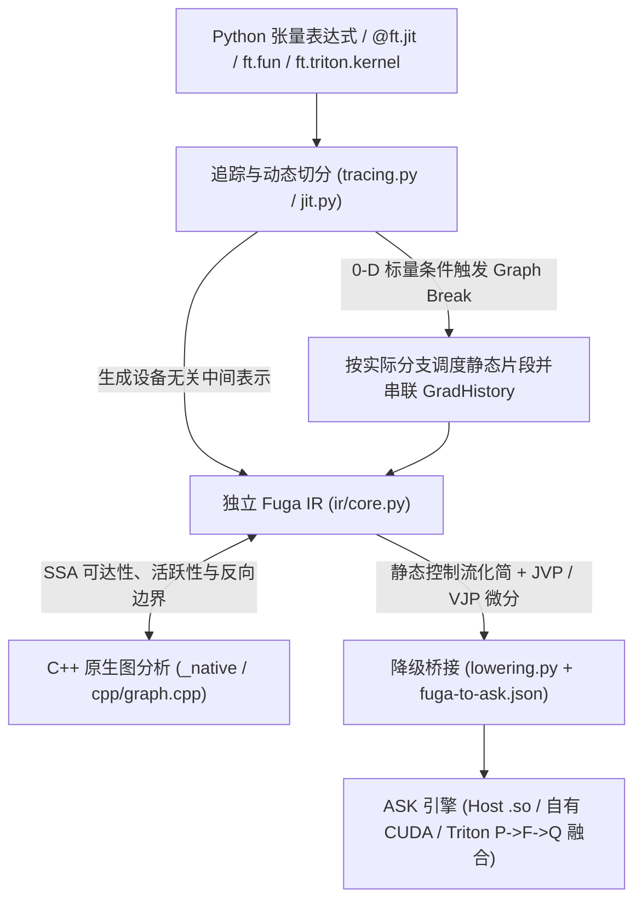

# FugaTensor 架构总览

目录导航：[文档首页](../README.md) · 中间表示：[Fuga IR 总览](../ir/README.md) · 底层引擎：[ASK 核心思想](../../../ask/docs/核心思想.md)

FugaTensor 的目标很纯粹：**给用户提供自然、可组合的 Python 张量编程与自动微分体验，同时自己绝不在 Python 里偷跑任何张量算术——每一条真实计算都编译成原生 CPU 代码或 CUDA kernel 交由 [ASK](../../../ask/docs/核心思想.md) 执行。**

这篇总览串联起一次张量调用从 Python 入口直达硬件执行的完整脉络，每节末尾均双向链接到对应的工程专题。

## 1. 两层系统边界：为什么 FugaTensor 不直接拼 ASK 字符串？

如果上层框架直接一边跑 Python 一边往 MLIR 字符串里塞指令，很快就会在嵌套控制流、自定义反向传播和高阶导数上陷入泥潭：静态后端只关心确定形状的单基本块数据流，而框架层必须表达未展开的 `if`/`for`/`while` 区域、`ft.fun` 自定义求导边界（`fuga.call`）以及前向/反向可组合变换。

因此，整个技术栈被清晰切为上下两层：

- **FugaTensor（框架层）**：管理用户态 `Tensor` 生命周期、Python 函数追踪、运行时 0-D 条件图中断（Graph Break）、基于独立 **Fuga IR** 的前向/反向自动微分（JVP/VJP）、C++ 原生反向路径预检与无用端口剪枝。
- **ASK（编译与运行时层）**：作为唯一算术执行后端，严格校验 `ask` dialect 静态图、执行常量折叠与逐元素融合、将自有算子或 `ASK → Triton → ASK` 跨编译器边界降级为原生机器码，并通过常驻 `ExecutionSession` 与双层磁盘缓存驱动硬件执行。

工程细节：[Fuga IR 总览](../ir/README.md) · [ASK 与 FugaTensor 协同分工](../../../ask/docs/07-FugaTensor协同与演进路线.md#division-of-labor)

## 2. 张量内存模型、JIT 特化与动态图中断

用户创建的 `ft.tensor` 只负责承载底层内存句柄（CPU 上的紧凑 `ctypes` 缓冲区或 CUDA 上的 ASK `DeviceTensor`）与自动微分元数据（`requires_grad`、`.grad`、`GradHistory`），就连 `x + y` 或 `x.astype("f16")` 这样的即时写法内部也是统一声明了 `@ft.jit` 的编译函数。

当调用 `@ft.jit` 函数时：

1. 先按所属 `Engine`、张量 `(shape, dtype)` 以及静态 Python 参数值生成**特化键**（张量具体数值与内存地址不入键，换数据直接走热路径复用机器码）。
2. 冷路径下将真实张量替换为只携带 `TensorType` 与 Fuga SSA `Value` 的 `TraceTensor`，运行一次 Python 函数记录 Fuga IR；嵌套的 `@ft.jit` 调用自然内联进同一张图，而 `ft.fun` 实例则保留为独立的 `fuga.call` 节点。
3. 若 Python `if` 或 `while` 读取了 0-D 标量 `TraceTensor` 的真值，追踪器会触发受控的 **Graph Break**：先把当前已积攒的前缀子图编译执行、读回单个标量真假，再在同一个 Python 栈帧里沿着真实命中的分支继续追踪后续片段，既不把首次运行的数据焊死进缓存，也不断开跨片段的反向求导链路。

工程细节：[01. 张量模型与追踪机制](01-张量模型与追踪机制.md)

## 3. 独立 Fuga IR 与 C++ 原生图分析

追踪生成的 `fugatensor.ir.Module` 是一套纯粹、设备无关的 SSA 对象图（支持嵌套 `Region` 与结构化验证）。无论最终跑在 CPU 还是 RTX GPU 上，相同的张量表达式都会生成完全一致的 Fuga IR。

在求导预检、死代码消除（DCE）和输出投影等高频图遍历环节，FugaTensor 将拓扑分析下沉到了必选的 `nanobind` C++ 扩展 `fugatensor._native`（`cpp/graph.cpp`）：

- 一次调用同时算出**前向种子可达集**、**输出逆向活跃集**、**受微分子图（active values/ops）**以及按逆拓扑排好序的**待求导边界序列**；
- 精确区分纯数据流与带副作用节点（effectful ops），确保未被选定输出依赖的悬空外部算子不会误触发反向缺规则报错；
- C++ 核心采用零全局可变状态的纯值语义并在计算期间释放 GIL，`ir/transforms.py` 基于它向求导器与执行引擎提供统一的 `analyze_function`、`prune` 与 `project_outputs` 基础设施。

工程细节：[02. 原生图分析与 C++ 边界](02-原生图分析与C++边界.md) · [Fuga IR 对象模型与验证](../ir/01-对象模型与验证.md)

## 4. 运行时自动微分、`ft.fun` 与高阶求导

FugaTensor 的公开求导界面采用直观的命令式风格：`requires_grad=True`、`y.backward(seed)` 与叶子张量 `.grad`（不暴露 `ft.grad(f)` 函数式外壳），而底层微分引擎则是完全构建在 Fuga IR 上的结构化图变换：

- **跨片段反向调度**：每次正向片段执行后，若存在需要梯度的输入，就在输出张量上挂载记录了本段 Fuga IR 模块与正向实参快照的 `GradHistory`。调用 `.backward()` 时先按拓扑逆序扫描整张历史 DAG 完成**预检（Preflight Validation）**——一旦发现必经路径上存在缺少反向规则的不透明外部算子，在启动任何反向编译或改写任何叶子 `.grad` 之前立即原子报错。
- **`ft.fun` 自定义算子**：用户继承 `ft.fun` 并为 `forward` 与可选 `backward` 加上 `@ft.jit`；追踪期生成保留 `saved` 中间值端口的 `fuga.call`，求导期将其无缝替换为用户的 `backward` Fuga IR 子图（包括手写 Triton 反向 kernel）。
- **可组合高阶求导（`create_graph=True`）**：因为基础算子（`add`、`mul`、`cast`、`constant`、`splat`）的 `jvp` 与 `vjp` 规则输出的依然是同构的 Fuga IR 基础算子，开启 `create_graph=True` 时反向传播本身也会作为普通 JIT 计算记录新的 `GradHistory`，从而支持二阶、三阶乃至更高阶导数。

工程细节：[03. 自动微分与自定义算子](03-自动微分与自定义算子.md) · [控制流与可组合变换](../ir/02-控制流与可组合变换.md)

## 5. 降级到 ASK、多后端执行与多级缓存

经过控制流化简、微分与无用输入端口裁剪后，`lower_to_ask` 将 Fuga IR 翻译为 ASK `Module`，同时写出 `fuga.ir`、`frontend.mlir` 与逐值溯源表 `fuga-to-ask.json`。随后由 `Engine` 按目标设备分派执行：

- **CPU（`HostBackend`）**：核对进程内 SDK 与配套 `ask-opt` 能力一致后，驱动 `ask-opt --optimize --emit-object` 生成目标文件并调用系统 `cc -shared` 链接成动态库，通过 `ctypes` 直接按编译报告中的端口 ABI 调用原生函数指针。
- **自有 CUDA（`CUDABackend`）**：无需安装或启用 Triton，直接从常驻 `ExecutionSession` 读取当前 GPU 真实 `sm_xx` 架构，调用 ASK 自有 CUDA 降级生成 `cubin` 并异步 `submit_many`。
- **用户手写 Triton 融合**：`ft.triton.kernel` 在不导入用户模块的前提下原样快照 `@triton.jit` 源码，延迟到目标 GPU 确定后填入架构号并生成 `ask.external`，交由 ASK Triton 适配器完成 `P → F → Q` 原生 LLVM IR 内联融合。
- **一键引导与五层缓存**：`python3 tools/bootstrap.py` 自动拉取锁定依赖、编译安装 ASK 与 FugaTensor 并写入 `.venv/share/fugatensor/engine.json`，运行时开箱即用，配合 FugaTensor 内存特化缓存与 ASK 磁盘级 LLVM IR / `cubin` 缓存实现热路径毫秒级调度。

工程细节：[04. ASK 桥接与多后端执行](04-ASK桥接与多后端执行.md) · [Fuga IR 降级到 ASK](../ir/03-降级到ASK.md)
