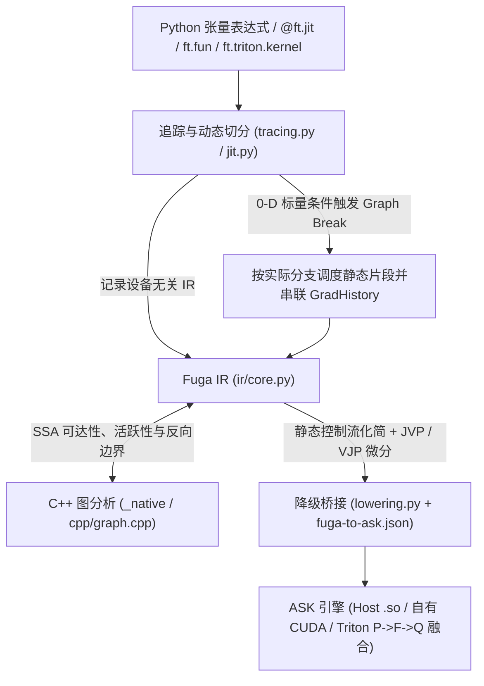

# FugaTensor 架构总览

目录导航：[文档目录](../README.md) · 中间表示：[Fuga IR 总览](../ir/README.md) · 底层引擎：[ASK 核心思想](../../../ask/docs/核心思想.md)

FugaTensor 负责 Python 张量接口、控制流切分、结构化中间表示（Fuga IR）与自动微分变换；所有张量算术计算均编译为原生 CPU 代码或 CUDA kernel 交由 [ASK](../../../ask/docs/核心思想.md) 执行。

## 1. 两层系统边界

静态编译后端接收的是形状确定、无动态分支的单基本块数据流，而上层框架还需要表达未展开的 `if`/`for`/`while` 区域、`ft.fun` 自定义求导边界（`fuga.call`）以及高阶导数变换。因此系统划分为两层：

- **FugaTensor（框架层）**：管理 `Tensor` 存储与梯度历史、Python 函数追踪、运行时 0-D 标量图中断（Graph Break）、基于独立 Fuga IR 的前向/反向自动微分（JVP/VJP）、C++ 反向路径预检与无用输入端口剪枝。
- **ASK（编译与运行时层）**：校验 `ask` dialect 静态图、执行常量折叠与逐元素融合、将自有算子或 `ASK → Triton → ASK` 跨编译器边界降级为目标机器码，并通过常驻 `ExecutionSession` 与双层磁盘缓存执行。

工程细节：[Fuga IR 总览](../ir/README.md) · [ASK 与 FugaTensor 协同分工](../../../ask/docs/07-FugaTensor协同与演进路线.md#division-of-labor)

## 2. 张量内存模型、JIT 特化与动态图中断

`ft.tensor` 持有底层内存句柄（CPU 上的紧凑 `ctypes` 缓冲区或 CUDA 上的 ASK `DeviceTensor`）与自动微分元数据（`requires_grad`、`.grad`、`GradHistory`）；`x + y`、`x.astype("f16")` 等基础运算内部均定义为 `@ft.jit` 函数。

调用 `@ft.jit` 函数时的执行顺序：

1. 按所属 `Engine`、张量 `(shape, dtype)` 及静态 Python 参数值生成特化键；张量元素值与内存地址不进入特化键，更换数据时直接复用已编译代码。
2. 未命中缓存时，将输入张量替换为携带 `TensorType` 与 Fuga SSA `Value` 的 `TraceTensor`，运行一次 Python 函数记录 Fuga IR；嵌套的普通 `@ft.jit` 调用直接内联进当前图，`ft.fun` 实例保留为独立的 `fuga.call` 节点。
3. 若 Python `if` 或 `while` 读取 0-D 标量 `TraceTensor` 的布尔值，追踪器触发 Graph Break：先编译并执行已记录的前缀子图、读回该标量真值，再在同一 Python 栈帧中沿实际分支继续追踪后续片段，并通过 `GradHistory` 连接各片段的反向链路。

工程细节：[01. 张量模型与追踪机制](01-张量模型与追踪机制.md)

## 3. 独立 Fuga IR 与 C++ 原生图分析

追踪产出的 `fugatensor.ir.Module` 是设备无关的 SSA 对象图（支持嵌套 `Region` 与结构化验证），同一函数在 CPU 与 CUDA 上生成相同的 Fuga IR。

求导预检、死代码消除（DCE）和输出投影依赖的图拓扑分析在必选 C++ 扩展 `fugatensor._native`（`cpp/graph.cpp`）中完成：

- 单次分析算出前向种子可达集、输出逆向可达集、带副作用保活集、微分子图交集以及逆拓扑待求导算子序列；
- 区分纯数据流与带副作用节点（effectful ops），未流向目标输出的外部算子不会进入反向求导序列；
- C++ 实现不持有全局可变状态并在分析期间释放 GIL，`ir/transforms.py` 在其上封装 `analyze_function`、`prune` 与 `project_outputs` 供求导与执行引擎共用。

工程细节：[02. 原生图分析与 C++ 边界](02-原生图分析与C++边界.md) · [Fuga IR 对象模型与验证](../ir/01-对象模型与验证.md)

## 4. 运行时自动微分、`ft.fun` 与高阶求导

公开求导接口采用 `requires_grad=True`、`y.backward(seed)` 与叶子张量 `.grad`，底层微分基于 Fuga IR 图变换实现：

- **跨片段反向调度与预检**：正向片段执行后，若输入含需要梯度的张量，输出张量会挂载记录本段 Fuga IR 与正向实参的 `GradHistory`。调用 `.backward()` 时先按拓扑逆序扫描历史 DAG 完成预检（Preflight Validation）：若必经路径上存在缺少反向规则的不透明外部算子，在启动反向编译或更新 `.grad` 之前直接报错。
- **`ft.fun` 自定义算子**：继承 `ft.fun` 并为 `forward` 与可选 `backward` 声明 `@ft.jit`；追踪期生成带 `saved` 中间值端口的 `fuga.call`，求导期将其替换为 `backward` 对应的 Fuga IR 子图（支持在 `backward` 中调用手写 Triton kernel）。
- **高阶求导（`create_graph=True`）**：基础算子（`constant`、`splat`、`add`、`mul`、`cast`）的 `jvp` 与 `vjp` 规则生成的仍是这五种基础算子；开启 `create_graph=True` 时，反向计算作为普通 `@ft.jit` 调用执行并继续记录 `GradHistory`，支持继续调用 `.backward()` 求高阶导数。

工程细节：[03. 自动微分与自定义算子](03-自动微分与自定义算子.md) · [控制流与可组合变换](../ir/02-控制流与可组合变换.md)

## 5. 降级到 ASK、多后端执行与多级缓存

完成控制流化简、微分与无用输入端口裁剪后，`lower_to_ask` 将 Fuga IR 转换为 ASK `Module`，写出 `fuga.ir`、`frontend.mlir` 与逐值映射表 `fuga-to-ask.json`，再由 `Engine` 分派执行：

- **CPU（`HostBackend`）**：核对进程内 SDK 与伴生 `ask-opt` 构建一致后，调用 `ask-opt --optimize --emit-object` 生成目标文件并由 `cc -shared` 链接为动态库，通过 `ctypes` 按报告中的端口 ABI 调用函数指针。
- **自有 CUDA（`CUDABackend`）**：从常驻 `ExecutionSession` 查询当前 GPU 的 `sm_xx` 架构，调用 ASK 自有 CUDA 降级生成 `cubin` 并异步 `submit_many`。
- **用户 Triton 融合**：`ft.triton.kernel` 读取并保存 `@triton.jit` 源码文本，在确定目标 GPU 后填入架构号生成 `ask.external`，交由 ASK Triton 适配器完成 `P → F → Q` 原生 LLVM IR 内联融合。
- **安装与缓存**：ASK 是必需的运行依赖，两个项目各自构建 wheel 后安装到同一环境；FugaTensor 自身的构建不读取 ASK 源码。CPU 包安装无需配置文件，CUDA 工具可通过引擎参数或环境变量指定，见[独立安装](../安装.md)。执行时结合 FugaTensor 内存特化缓存与 ASK 磁盘级 LLVM IR / `cubin` 缓存复用编译结果。

工程细节：[04. ASK 桥接与多后端执行](04-ASK桥接与多后端执行.md) · [Fuga IR 降级到 ASK](../ir/03-降级到ASK.md)
