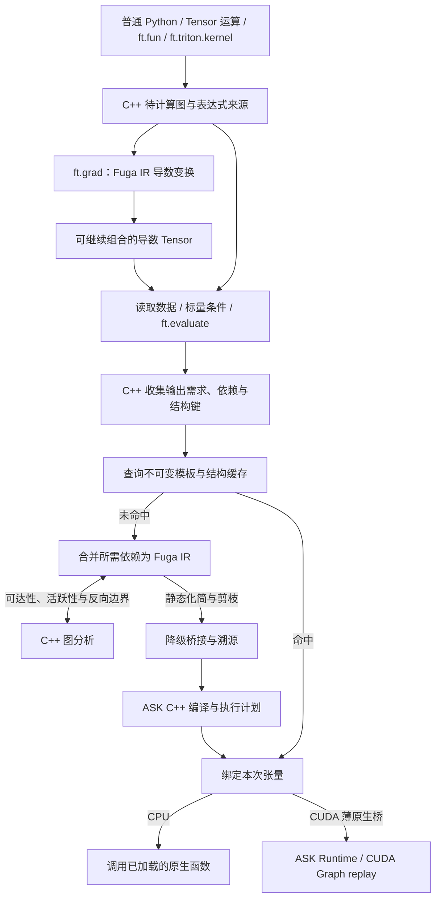

# FugaTensor 架构总览

目录导航：[文档目录](../README.md) · 接口用法：[API](../API/README.md) · 中间表示：[Fuga IR 总览](../ir/README.md) · 底层引擎：[ASK 核心思想](../../../ask/docs/核心思想.md)

FugaTensor 提供 Python 张量接口，在 Fuga IR 上组图、求导，再交给 [ASK](../../../ask/docs/核心思想.md) 编译为 CPU 或 CUDA 代码执行。

## 1. 两层系统边界

Fuga IR 保存框架层的控制流和求导信息；降级后的 ASK IR 是形状确定的单基本块计算图。

- FugaTensor 管理 Tensor、表达式来源与函数式求导，处理 Python 控制流、自定义函数追踪、JVP/VJP 和图剪枝，同时调用第三方 worker、维护编译缓存。
- ASK 校验和优化静态图，融合自有逐元素计算，生成机器码和执行计划。C++ 运行时负责参数绑定、计划提交、缓冲区、事件和 CUDA Graph replay。

工程细节：[Fuga IR 总览](../ir/README.md) · [ASK 与 FugaTensor 协同分工](../../../ask/docs/FugaTensor协同与演进路线.md#division-of-labor)

## 2. 张量模型、自动组图与执行边界

Tensor 持有 CPU/CUDA 存储，或记录待计算表达式及其形状、类型和设备。`x + y`、`x.astype(ft.fp16)`、`x.reshape(2, 2)` 等运算自动组图，跨 Python 函数产生的表达式也可合并。

读取数据、判断 0-D 标量条件或调用 `ft.evaluate(...)` 时触发 JIT；`ft.grad` 构造的导数 Tensor 使用相同执行边界。引擎先按模板及连接关系查缓存，未命中时合并 Fuga IR 并编译。`ft.evaluate(a, b)` 可一起计算多个输出，结果存回 Tensor。连续内存可通过 `from_buffer` / `to_buffer` 批量传递。

Python `if` / `while` 读取条件 Tensor 的真值后选择路径，后续运算继续组图。`ft.fun` 的隔离追踪只接受由静态元信息决定的分支，数据依赖分支应放在外层 Python 代码中。

工程细节：[张量模型与追踪机制](张量模型与追踪机制.md)

## 3. 独立 Fuga IR 与 C++ 原生图分析

`fugatensor.ir.Module` 是含嵌套 `Region` 的 SSA 对象图，类型和 SSA 值与设备分开保存。

C++ 扩展 `fugatensor._native`（`cpp/graph.cpp`）计算输入可达集、输出依赖、带副作用节点的保活范围及反向遍历顺序。`ir/transforms.py` 用这些结果实现 `analyze_function`、`prune` 和 `project_outputs`，供求导与执行引擎共用。分析期间释放 GIL，各次调用使用独立状态。

`cpp/lazy.cpp` 用连续节点池保存待计算图和求导来源，Python Tensor 通过原生值编号访问。原语参数绑定由 `cpp/primitive.cpp` 完成；`cpp/trace.cpp` 保存隔离追踪节点，在追踪结束时导出 Fuga IR。求值边界在 C++ 中合并输出需求、绑定已有存储并校验活跃定义；缓存键结合增量指纹与精确连接关系。

工程细节：[原生图分析与 C++ 边界](原生图分析与C++边界.md) · [Fuga IR 对象模型与验证](../ir/对象模型与验证.md)

## 4. 函数式自动微分、`ft.fun` 与高阶求导

调用 `ft.grad(outputs, inputs, seed=...)` 对指定表达式求导。该调用生成 Fuga IR 导数图，并返回待计算 Tensor。

- Tensor 求值后保留表达式来源，重复求导和中间张量求导通过同一套 IR 变换完成。
- `ft.fun` 追踪为 `fuga.call`；普通前向自动微分，可选的 `vjp` 接收输入原值、前向输出与余切三个 tuple，其中可以调用手写 Triton kernel。
- 导数 Tensor 可以继续参与运算和高阶求导；`detach` / `stop_gradient` 显式断开路径，未连接的求导输入得到零。

工程细节：[自动微分与自定义算子](自动微分与自定义算子.md) · [控制流与可组合变换](../ir/控制流与可组合变换.md)

## 5. 降级到 ASK、多后端执行与多级缓存

图缓存未命中时，FugaTensor 化简控制流、裁剪输入，再由 `lower_to_ask` 生成 ASK IR。`Engine` 保存 `fuga.ir`、`frontend.mlir` 和逐值映射表 `fuga-to-ask.json`，随后编译执行：

- CPU：ASK 生成目标文件，`cc -shared` 链接为动态库，`HostBackend` 通过 `ctypes` 调用。`ask_opt` 参数可选择 CLI 入口。
- 自有 CUDA：ASK 生成 LLVM IR，`llc` / `ptxas` 生成 cubin，`PreparedProgram::run` 提交整段计划，默认使用 CUDA Graph。
- Triton：worker 编译源码并返回 cubin。ASK 按[执行计划 v1](../../../ask/docs/图切分与多Kernel执行计划.md#plan-v1)切分自有区域和外部节点，在同一 stream 上提交。
- 缓存：引擎先查结构缓存，再组合图和生成文本；LLVM IR 与 cubin 另有磁盘缓存。普通 Python 逻辑每次执行。

工程细节：[ASK 桥接与多后端执行](ASK桥接与多后端执行.md) · [Fuga IR 降级到 ASK](../ir/降级到ASK.md) · [多 kernel 执行计划](../../../ask/docs/图切分与多Kernel执行计划.md)

## 6. 权重格式与导出

权重用嵌套 `dict`、`list`、`tuple` 和 Tensor 叶子表示。导出目录包含 `manifest.json` 和按内容寻址的 little-endian 数组文件；加载器校验树、数组描述、摘要和路径后，在选定设备创建 Tensor。参数命名和网络结构由调用方定义。

工程细节：[权重格式与导出](权重格式与导出.md#weight-goals)
