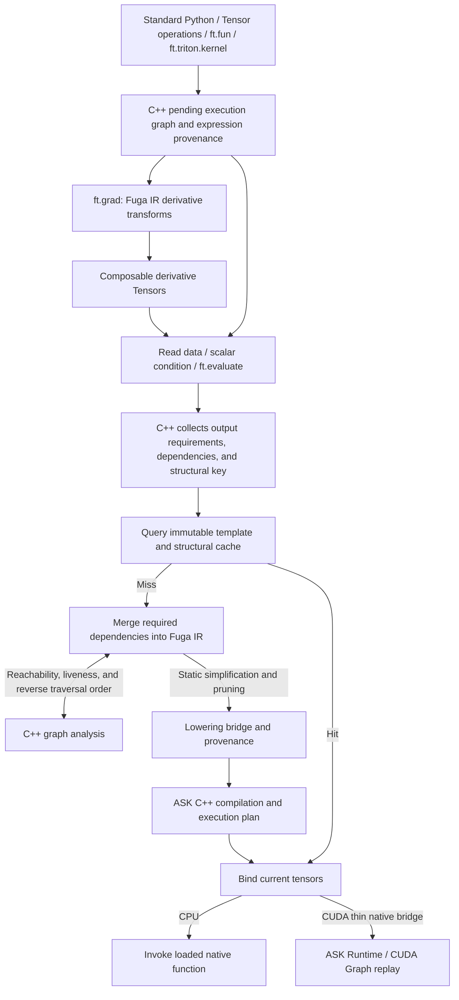

# FugaTensor Architecture Overview

Navigation: [Documentation Index](../README.md) · API Usage: [API](../API/README.md) · Intermediate Representation: [Fuga IR Overview](../ir/README.md) · Underlying Engine: [ASK Core Concepts](../../../../ask/docs/en/concepts.md)

FugaTensor provides a Python tensor interface, constructs graphs and computes derivatives on Fuga IR, and hands them off to [ASK](../../../../ask/docs/en/concepts.md) for compilation and execution as CPU or CUDA code.

## 1. Two-Tier System Boundary

Fuga IR preserves framework-level control flow and automatic differentiation information; the lowered ASK IR is a shape-concrete single-basic-block computation graph.

- FugaTensor manages Tensors, expression provenance, and functional differentiation, handling Python control flow, custom function tracing, JVP/VJP, and graph pruning, while invoking third-party workers and maintaining compilation caches.
- ASK validates and optimizes the static graph, fuses owned elementwise computations, and generates machine code and execution plans. The C++ runtime handles argument binding, plan dispatch, buffers, events, and CUDA Graph replay.

Engineering details: [Fuga IR Overview](../ir/README.md) · [ASK and FugaTensor Division of Labor](../../../../ask/docs/en/fugatensor.md#division-of-labor)

## 2. Tensor Model, Automatic Graph Construction, and Execution Boundary

A Tensor holds CPU/CUDA storage, or records a pending expression along with its shape, dtype, and device. Operations like `x + y`, `x.astype(ft.fp16)`, and `x.reshape(2, 2)` automatically construct graphs; expressions generated across Python functions can also be merged.

Reading data, evaluating a 0-D scalar condition, or calling `ft.evaluate(...)` triggers JIT compilation; derivative Tensors constructed by `ft.grad` use the same execution boundary. The engine first queries the cache using the template and connection topology; upon a miss, it merges the Fuga IR and compiles it. `ft.evaluate(a, b)` can evaluate multiple outputs together and write results back into Tensors. Contiguous memory can be transferred in bulk via `from_buffer` / `to_buffer`.

Python `if` / `while` statements read the truth value of a condition Tensor to choose an execution path, and subsequent operations continue graph construction. Isolated tracing in `ft.fun` only accepts branches determined by static metadata; data-dependent branching should remain in outer Python code.

Engineering details: [Tensor Model and Tracing Mechanism](tensor_model.md)

## 3. Independent Fuga IR and Native C++ Graph Analysis

`fugatensor.ir.Module` is an SSA object graph containing nested `Region`s, where types and SSA values are maintained separately from devices.

The C++ extension `fugatensor._native` (`cpp/graph.cpp`) computes input reachable sets, output dependencies, keep-alive ranges for side-effecting nodes, and reverse traversal order. `ir/transforms.py` uses these results to implement `analyze_function`, `prune`, and `project_outputs`, shared by both autograd and the execution engine. The GIL is released during analysis, and each invocation uses independent state.

`cpp/lazy.cpp` uses a contiguous node pool to store pending execution graphs and differentiation provenance, accessed by Python Tensors via native value IDs. Primitive argument binding is handled by `cpp/primitive.cpp`; `cpp/trace.cpp` stores isolated trace nodes and exports Fuga IR when tracing finishes. The evaluation boundary in C++ merges output requirements, binds existing storages, and validates live definitions; cache keys combine incremental fingerprints with exact connectivity topology.

Engineering details: [Native Graph Analysis and C++ Boundary](native.md) · [Fuga IR Object Model and Verification](../ir/model.md)

## 4. Functional Automatic Differentiation, `ft.fun`, and Higher-Order Derivatives

Calling `ft.grad(outputs, inputs, seed=...)` differentiates the specified expressions. This invocation generates a Fuga IR derivative graph and returns pending Tensors.

- Tensors retain their expression provenance after evaluation; repeated differentiation and differentiation with respect to intermediate tensors are completed through the same set of IR transformations.
- `ft.fun` traces into `fuga.call`; standard forwards are automatically differentiated, and an optional `vjp` receives three tuples (primals, forward outputs, and cotangents), within which handwritten Triton kernels can be invoked.
- Derivative Tensors can continue to participate in operations and higher-order differentiation; `detach` / `stop_gradient` explicitly sever differentiation paths, while unconnected gradient inputs yield zeros.

Engineering details: [Automatic Differentiation and Custom Operators](autograd.md) · [Control Flow and Composable Transformations](../ir/transforms.md)

## 5. Lowering to ASK, Multi-Backend Execution, and Multi-Level Caching

When a graph cache miss occurs, FugaTensor simplifies control flow, prunes inputs, and generates ASK IR via `lower_to_ask`. `Engine` saves `fuga.ir`, `frontend.mlir`, and the value-by-value mapping table `fuga-to-ask.json`, then compiles and executes:

- CPU: ASK generates an object file, `HostBackend` links SDK-declared libraries according to the ABI, and invokes dynamic library functions via `ctypes`; fp32 matrix multiplication uses OpenBLAS. The `ask_opt` parameter selects the CLI entry point.
- Owned CUDA: ASK generates LLVM IR, `llc` / `ptxas` produce the cubin, and `PreparedProgram::run` submits the whole-segment plan, defaulting to CUDA Graph.
- Triton: The worker compiles source code and returns a cubin. ASK partitions owned regions and external nodes according to [Execution Plan v1](../../../../ask/docs/en/partitioning.md#plan-v1), dispatching them on the same stream.
- Caching: The engine queries the structural cache first, before combining graphs and generating text; LLVM IR and cubin have separate disk caches. Standard Python logic executes every time.

Engineering details: [ASK Bridge and Multi-Backend Execution](backend.md) · [Lowering Fuga IR to ASK](../ir/lowering.md) · [Multi-Kernel Execution Plan](../../../../ask/docs/en/partitioning.md)

## 6. Weight Format and Export

Weights are represented as PyTrees composed of nested `dict`, `list`, `tuple`, and Tensor leaves. The export directory contains `manifest.json` and content-addressed little-endian array files; the loader verifies the tree, array descriptions, digests, and paths, then creates Tensors on the chosen device. Parameter naming and network structures are defined by the caller.

Engineering details: [Weight Format and Export](weights.md#weight-goals)
